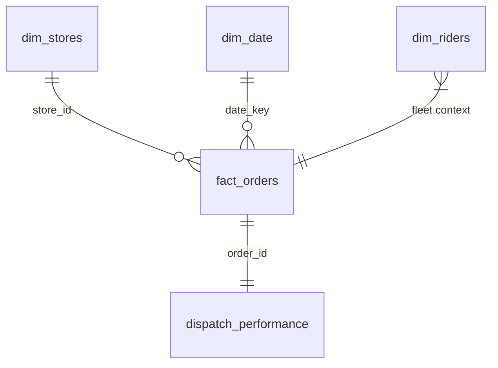

# KitchenSync AI: Power BI Business Intelligence Implementation Guide

## 1. Star Schema Architecture

The analytical layer is structured as a Kimball-style star schema centered on operational delivery transactions.



### Table Relationships:
1. `fact_orders[store_id]` -> `dim_stores[store_id]` (Many-to-One, Single Direction)
2. `fact_orders[date_key]` -> `dim_date[date_key]` (Many-to-One, Single Direction)
3. `dispatch_performance[order_id]` -> `fact_orders[order_id]` (One-to-One, Bi-directional)

---

## 2. Power BI Data Ingestion & Refresh

### Method A: Automated CSV Ingestion
1. Open **Power BI Desktop**.
2. Click **Get Data** -> **Folder** (or Text/CSV).
3. Select the `powerbi/` directory inside this repository.
4. Import:
   - `fact_orders.csv`
   - `dim_stores.csv`
   - `dim_riders.csv`
   - `dim_date.csv`
   - `dispatch_performance.csv`
5. In Model View, verify relationships as specified above.

### Method B: Direct SQLite ODBC Connection (Optional)
If SQLite ODBC Driver is installed:
- DSN: SQLite3 Datasource pointing to `data/food_delivery.db`.
- Query: Direct SQL imports using queries from `src/database/queries.sql`.

### Scheduled Refresh via Python
To refresh Power BI data at any time from live SQLite changes, run:
```bash
python -m src.utils.export_powerbi
```
In Power BI Desktop, click **Home** -> **Refresh**.

---

## 3. Required Dashboard Visuals & Layout

### Page 1: Executive Overview
- **KPI Cards:**
  - `[Total Orders]`
  - `[On Time Delivery %]` (Target: >90%)
  - `[Average Prep Time]`
  - `[Cancellation Rate]` (Target: <3%)
- **Line Chart:** Hourly Order Volume vs Average Preparation Time.
- **Donut Chart:** Orders by Traffic Level (`Low`, `Medium`, `High`, `Jam`).

### Page 2: Kitchen Analytics
- **Clustered Bar Chart:** Actual Prep Time vs Predicted P50 vs Predicted P90 by `dim_stores[store_name]`.
- **Scatter Plot:** Kitchen Queue Depth vs Actual Prep Time.
- **Table:** Top Bottleneck Restaurants (filtered by highest `Average Prep Time` and `Food Wait for Rider`).

### Page 3: Rider & Dispatch Efficiency
- **KPI Cards:**
  - `[Average Dispatch Delay]`
  - `[Food Wait for Rider]` (Minutes food sits on counter)
  - `[Rider Wait for Food]` (Minutes courier waits at store)
- **Bar Chart:** Dispatch Delay Distribution across Weather Conditions.
- **Gauge Chart:** On-Time Delivery % with 90% target threshold.

### Page 4: Store Performance Scorecard
- **Matrix Table:**
  - Rows: `store_name`, `location`
  - Values: `[Total Orders]`, `[Average Prep Time]`, `[On Time Delivery %]`, `[Food Wait for Rider]`
  - Conditional Formatting: Color scale on `On Time Delivery %` (Green >= 90%, Red < 80%).
